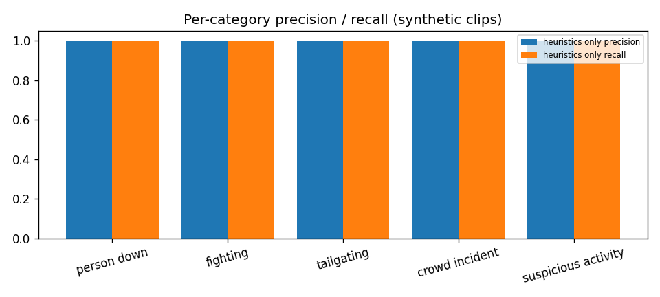
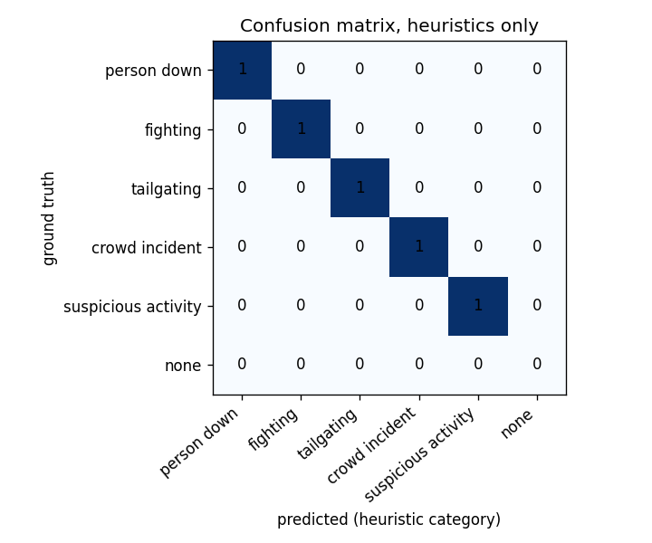

# Vigil evaluation report

_Generated 2026-10-15T14:44:46+0000 by `eval/make_report.py` from `eval/results/eval.json`. Every number below comes from that file; nothing is estimated or copied from elsewhere._

## 1. Read this first

- **What was run:** the real pipeline (YOLOv8n + ByteTrack + heuristics + storage) on `linux`, Python 3.11.17, detector device override `cpu`, base profile `configs/profile_gtx1650.yaml`.
- **VLM verification:** **NOT EXECUTED** (no Ollama/VLM was reachable). Every candidate was stored as `unverified`, so the VLM columns of the ablation do not exist.
- **Retrieval (CLIP + Chroma):** **NOT EXECUTED** - CLIP unavailable: EmbedderUnavailable: CLIP ViT-B-32/openai could not be loaded (FileNotFoundError: Failed to download file (open_clip_pytorch_model.bin) for timm/vit_base_patch32_clip_224.openai. Last error: An error happened while trying.
- **GPU / macOS / Windows:** **NOT EXECUTED** in this report (the sandbox is a 2-core x86-64 Linux CPU machine). See section 8 for the exact commands.
- **Data:** all clips are **synthetic** (person cut-outs pasted on a plain floor, `scripts/make_demo_clips.py`). They show that every stage works end to end and are deterministic, but they say **very little about accuracy on real CCTV footage**. The fighting clip's choreography was tuned until the heuristic fired, so its result is not independent evidence.
- `confidence_score` is an uncalibrated ranking heuristic, not a probability.

## 2. Clips

| clip | camera | ground truth | duration |
|---|---|---|---|
| `data/clips/person_down_01.mp4` | cam1 | person down | 12 s |
| `data/clips/tailgating_01.mp4` | cam2 | tailgating | 8 s |
| `data/clips/tailgating_negative_01.mp4` | cam2 | none | 12 s |
| `data/clips/suspicious_01.mp4` | cam1 | suspicious activity | 16 s |
| `data/clips/crowd_01.mp4` | cam1 | crowd incident | 12 s |
| `data/clips/fighting_01.mp4` | cam1 | fighting | 10 s |
| `data/clips/eval/normal_01.mp4` | cam1 | none | 600 s |

Total footage 11.2 min, of which 10.2 min is event-free.

Not run (datasets listed in `eval/manifest.csv` as `not_run`; download them yourself and add rows):

- `external/RWF-2000` (fighting): external dataset (RWF-2000; not bundled / not downloaded)
- `external/UR-Fall` (person down): external dataset (UR Fall Detection; not bundled / not downloaded)
- `external/Le2i` (person down): external dataset (Le2i fall dataset; not bundled / not downloaded)

## 3. Detection results: heuristics only (tolerance +/-2.0 s)

| category | GT events | TP | FP | FN | precision | recall | F1 |
|---|---|---|---|---|---|---|---|
| person down | 1 | 1 | 0 | 0 | 100% | 100% | 100% |
| fighting | 1 | 1 | 0 | 0 | 100% | 100% | 100% |
| tailgating | 1 | 1 | 0 | 0 | 100% | 100% | 100% |
| crowd incident | 1 | 1 | 0 | 0 | 100% | 100% | 100% |
| suspicious activity | 1 | 1 | 0 | 0 | 100% | 100% | 100% |
| **all (micro)** | 5 | 5 | 0 | 0 | 100% | 100% | 100% |

- Duplicate same-category events inside an already-detected interval: 0 (not counted as false alarms).
- **False alarms per hour, event-free footage only:** 0.0 (from 10.2 min of footage; a small denominator - treat as indicative).
- False alarms per hour, all footage: 0.0.
- Candidates stored: 5; unverified fraction: 100%.

When the alert fired (media time inside the clip):

| clip | category | GT interval | alert at | delay after GT start |
|---|---|---|---|---|
| `person_down_01.mp4` | person down | 4.0-12.0 s | 6.8 s | 2.8 s |
| `tailgating_01.mp4` | tailgating | 2.0-3.0 s | 2.9 s | 0.9 s |
| `suspicious_01.mp4` | suspicious activity | 2.0-14.0 s | 10.1 s | 8.1 s |
| `crowd_01.mp4` | crowd incident | 2.0-12.0 s | 3.1 s | 1.1 s |
| `fighting_01.mp4` | fighting | 1.5-10.0 s | 2.9 s | 1.4 s |

Delays are mostly by design (hold times such as `person_down.hold_s`, `suspicious.loiter_s`, `fighting.min_duration_s`).

## 4. Ablation: heuristics only vs VLM-assisted

**NOT EXECUTED**. no event carries a VLM verdict (Ollama/VLM not reachable during this run); vlm_assisted would equal heuristics_only

What this means: the system's behaviour *without* a VLM is exactly the heuristics-only table above, with every event labelled `unverified`. Whether the VLM removes false alarms (or wrongly rejects true events) is **not measured here**.

To produce it on a machine with Ollama: `python scripts/download_models.sh`, then `python eval/run_eval.py --profile configs/profile_<yours>.yaml && python eval/make_report.py`.

## 5. Reliability of the score

| heuristic score | events | true detections | fraction |
|---|---|---|---|
| 0.00-0.50 | 1 | 1 | 100% |
| 0.50-0.70 | 3 | 3 | 100% |
| 0.70-0.85 | 1 | 1 | 100% |

Few events per bucket: this is a sanity check that higher scores are not worse, not a calibration curve.

## 6. Retrieval

**NOT EXECUTED**: CLIP unavailable: EmbedderUnavailable: CLIP ViT-B-32/openai could not be loaded (FileNotFoundError: Failed to download file (open_clip_pytorch_model.bin) for timm/vit_base_patch32_clip_224.openai. Last error: An error happened while trying.

Query parsing, structured filtering and the hybrid-scoring maths are covered by unit tests (`tests/test_query.py`), which use a hash stub embedder and therefore prove the *plumbing*, not semantic quality. Run `python eval/run_eval.py ...` with CLIP weights cached (`bash scripts/download_models.sh`) to fill this in.

## 7. Latency and resources (this CPU sandbox only)

- VLM latency: **NOT EXECUTED**

Per-stage latency while replaying `normal_01.mp4` (offline, as fast as possible, CPU):

| stage | n | p50 ms | p95 ms |
|---|---|---|---|
| detect | 2000 | 94.1 | 118.8 |
| ingest_to_detect | 2000 | 3011.8 | 3427.8 |

`n` is the number of samples kept by the bounded metrics window, not the frame count. `ingest_to_detect` is queue wait: offline replay runs the reader faster than the detector, so it is back-pressure, not real-time latency.

Process RSS at the end of the run: 1969 MB (peak 1971 MB). No GPU memory figure: no GPU present.

These are **CPU** numbers on 2 cores. They say nothing about the RTX 2050 / GTX 1650 / M4 targets.

### VLM model benchmark

**NOT EXECUTED**. `scripts/benchmark_models.py` needs Ollama and the candidate models on the target machine. Until it has run, the profiles keep the *default* `moondream` and that choice is **unverified**. Run `python scripts/benchmark_models.py --pull --write-profile` on each machine.

## 8. Verification status by platform

`scripts/diagnose.py` on the sandbox (`eval/results/diagnose_sandbox.json`):

| check | status | detail |
|---|---|---|
| cuda | NOT_RUN | no NVIDIA GPU detected |
| mps | NOT_RUN | not an Apple Silicon machine |
| profile validation | PASS | gtx1650: valid |
| opencv video decode | PASS | cv2 4.10.0: decoded 10/10 frames |
| yolo one-image detection | PASS | 4 objects, 4 people on cpu; load 0.03s, 1 inference 0.108s (bus.jpg) |
| bytetrack | PASS | BYTETracker constructed and updated |
| ollama connectivity | NOT_INSTALLED | the `ollama` command was not found. Ollama is not reachable at http://localhost:11434. Install it from https:/ |
| vlm one-image inference | NOT_RUN | Ollama not reachable |
| clip checkpoint load | MODEL_UNAVAILABLE | CLIP ViT-B-32/openai could not be loaded (FileNotFoundError: Failed to download file (open_clip_pytorch_model. |
| clip image embedding | NOT_RUN | checkpoint not loaded |
| clip text embedding | NOT_RUN | checkpoint not loaded |
| sqlite read/write | PASS | sqlite 3.45.1, journal_mode=wal |
| chromadb persistence | PASS | chromadb 0.5.23: vector survived reopen |
| streamlit import | PASS | 1.40.2 |
| pyarrow (dashboard tables) | PASS | 17.0.0 |
| streamlit startup | PASS | health endpoint on :59077 ok |

| target | status | command that verifies it |
|---|---|---|
| Linux x86-64 CPU (sandbox) | tests + eval executed here | `python -m pytest -q` |
| Windows + NVIDIA RTX 2050 | **unverified** | `python scripts/diagnose.py --profile configs/profile_rtx2050.yaml` then `python scripts/benchmark_models.py --pull --write-profile` |
| Windows + NVIDIA GTX 1650 | **unverified** | `python scripts/diagnose.py --profile configs/profile_gtx1650.yaml` |
| macOS M4 (MPS) | **unverified** | `python scripts/diagnose.py --profile configs/profile_mac_m4.yaml` |
| Ollama VLM path | unit-tested against a mock HTTP server only | `python scripts/diagnose.py` (checks the real server) |
| CLIP weights | code path tested with random weights only | `bash scripts/download_models.sh` then `python scripts/diagnose.py` |

## 9. Test suite

`python -m pytest -q` on the Linux CPU sandbox (Python 3.11): **143 passed, 1209 warnings in 30.13s**. Executed 2026-10-15; Windows and macOS runs: **NOT EXECUTED**.

Tests use fakes (detector, verifier), a mock Ollama HTTP server and a hash stub embedder. They check logic, failure handling and shutdown, not model quality.

## 10. Known limitations

- Clips are synthetic (pasted person cut-outs on a plain floor); results show the pipeline works end to end, not real-world accuracy.
- The fighting clip's choreography was tuned until the heuristic fired.
- confidence_score is an uncalibrated ranking heuristic, not a probability.
- **History of this result:** a first eval run (before the fix below) *missed* the fighting clip although the heuristic fired on it in isolation. Cause: velocity-window boundaries depended on float rounding of the timestamps (epoch-sized timestamps flipped a 4-frame window into 5 frames on 15-40% of frames), so the trigger was knife-edge. `TrackState._obs_at_or_before` now has a 1 ms tolerance and `tests/test_heuristics.py::test_velocity_window_independent_of_timestamp_offset` guards it; all numbers above are from the run after the fix. The fighting rule is still sensitive to its `motion_energy_min` threshold.
- Heuristic thresholds are untuned defaults chosen for the synthetic clips; real cameras need per-camera tuning in `configs/cameras.yaml`.
- 2-D boxes cannot separate a fight from hugging, or a fall from sitting down; the VLM stage exists for that, but its effect is not measured here.
- One manifest row per ground-truth interval and a +/-tolerance match rule: small sample sizes mean percentages jump by large steps.
